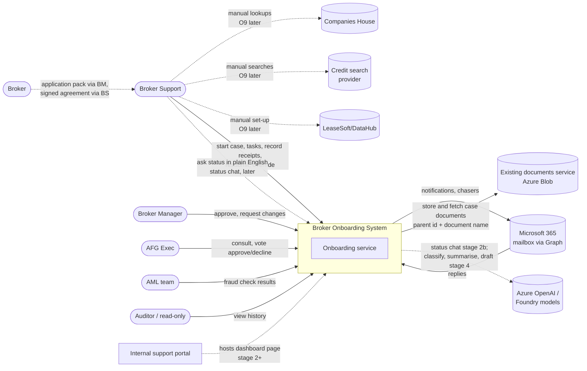
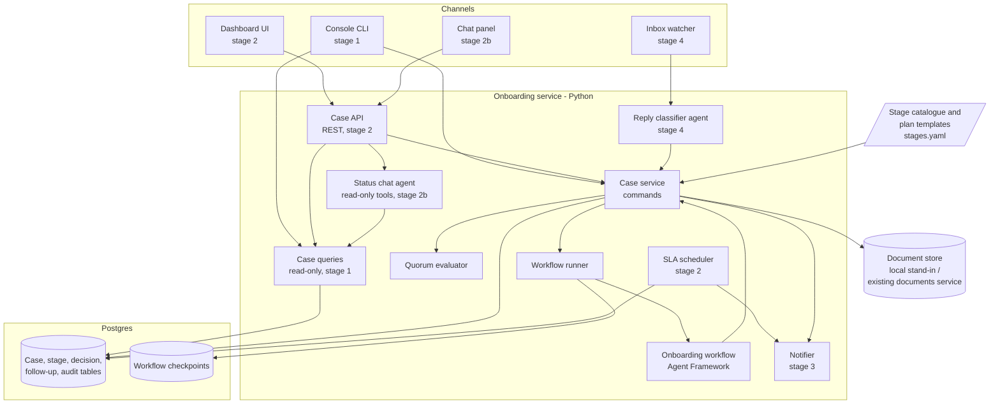
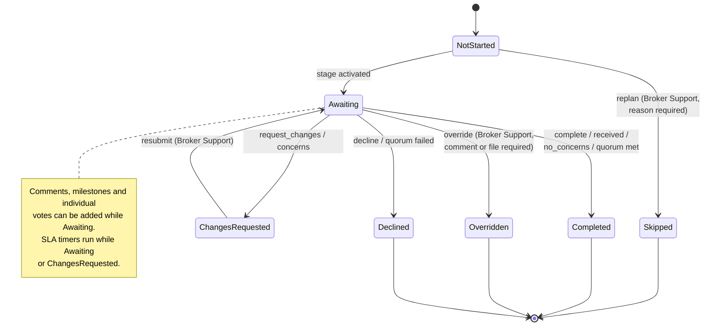
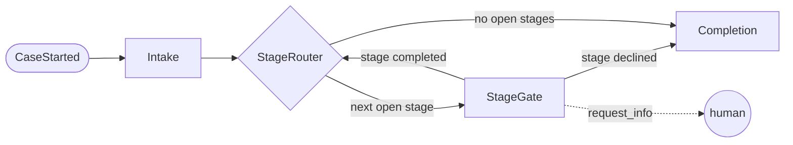
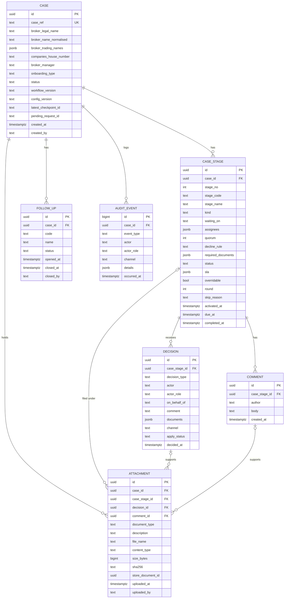
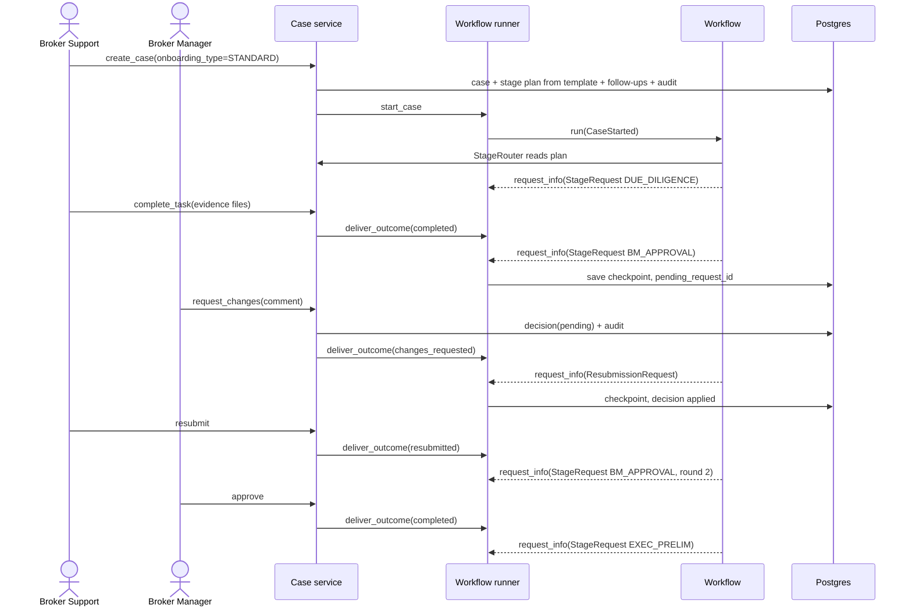
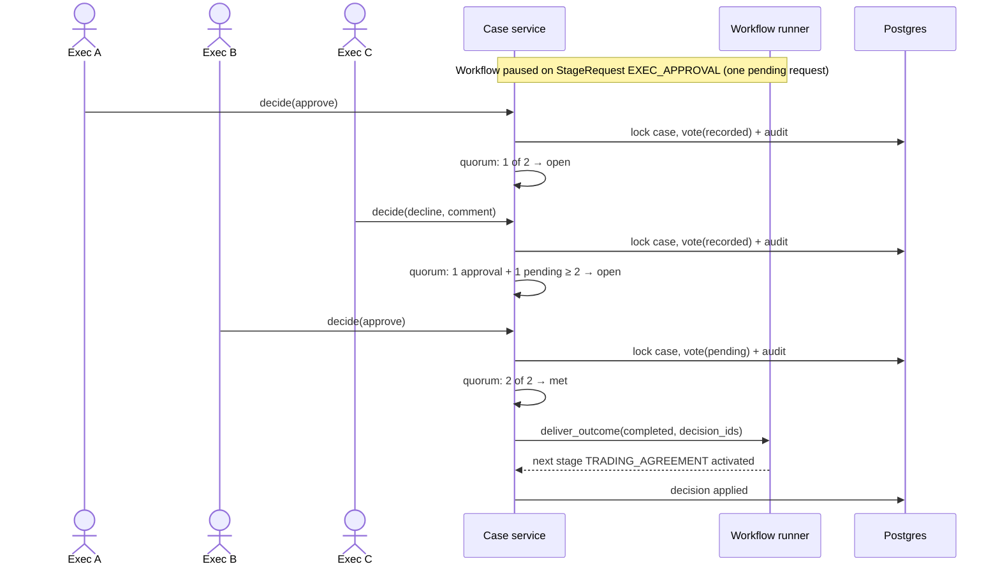
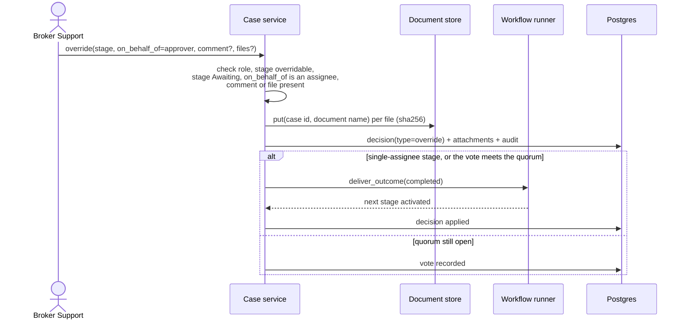

# Broker Onboarding Workflow – Architecture & System Design

Status: **living document**. It describes the design as intended and is updated as components are built. Each component shows its delivery stage and build status.

Related: [OBJECTIVES.md](OBJECTIVES.md) (the why), [BusinessWorkflow.md](BusinessWorkflow.md) (the business process), section numbers below (the how).

| Status key | Meaning |
|---|---|
| 🟦 Designed | Design agreed, not built |
| 🟨 In progress | Being built |
| 🟩 Built | Built and demoed |
| ⬜ Later | Outline only, depends on discovery or later stages |

---

## 1. Architecture overview

### 1.1 Guiding principles

1. **Thin workflow, our own state.** The Agent Framework workflow only decides "what's the next step" and holds the pause/resume point. The case, stage, decision, vote, audit and file data live in our own tables, which are the **system of record** (O4, O5).
2. **Stages are data, planned per case.** Configuration defines a catalogue of stages and a plan template for each onboarding type. Each case gets its own stage plan, copied from its template into the case tables when the case is created. The workflow graph never names a business stage, so stages can be added, reordered or skipped without changing the workflow.
3. **Every channel ends in the same place.** Console, dashboard, email link, email reply and Broker Support override all become a decision recorded by the case service. When a decision settles a stage, it's delivered to the paused workflow as a `StageOutcome`.
4. **Always know who we're waiting on.** Every stage has a `waiting_on` category, so elapsed time can be totalled per category. This is the data behind Objective 0.
5. **One read path.** The dashboard, the command line and the status chat all read case status through the same read-only query layer (§3.12). Nothing reads workflow checkpoints to answer "where is this case?"
6. **AI suggests, people decide.** Model calls are optional nodes that never approve anything by themselves (O7). The status chat is read-only (O10).
7. **Easy to port, easy to host.** Configuration comes from the environment. Storage, clock and notifications sit behind small interfaces, so local versions can be swapped for Azure ones, and the workflow layer can be rewritten in .NET (Objectives §8).

### 1.2 System context



The broker is not a user of the system. Broker Support records what the broker sends. Companies House, credit search and LeaseSoft/DataHub are used manually in the POC. Broker Support attaches the evidence to the relevant task.

### 1.3 Containers and components



**Data ownership:**
- The **case service** is the only component that writes the case tables.
- **Case queries** is the only read path for case status. The dashboard, the command line and the status chat all use it. It applies the same access checks as the case service, and it has no write methods.
- The **workflow runner** is the only component that reads and writes checkpoints.
- Executors in the workflow call back into the case service to record what happened. They never write SQL directly.
- The **documents service** owns the file bytes. Our `attachment` table owns which case, stage, decision or comment a document belongs to, and who uploaded it. Only the case service calls the documents service, so access is always checked against the case first.
- The **quorum evaluator** is a pure function inside the case service. It reads a stage's decisions and returns `open`, `met` or `failed`.

---

## 2. Domain model

### 2.1 Concepts

| Concept | Description |
|---|---|
| **Case** | One broker onboarding. Has a `case_ref` (e.g. `BRK-2026-0001`) that's used in email subjects and links. Records the broker's assigned Broker Manager. |
| **Broker identity** | The broker's legal name, trading names or aliases, Companies House number, and a normalised name for matching. Lets people (and the chat) find a case from "Acme Brokerage" when the legal name is "Acme Brokers Ltd". |
| **Onboarding type** | The kind of onboarding, e.g. `STANDARD`. Chosen when the case is created. Selects the plan template. Only `STANDARD` is known so far (Objectives Q2). |
| **Stage catalogue** | Every stage that exists (code, name, kind, waiting on, assignees, quorum, SLA, overridable), with no order. Defined in config. |
| **Plan template** | For one onboarding type, the ordered list of catalogue stages to use by default, plus its follow-ups. Defined in config. |
| **Stage plan** | A case's own ordered list of stages. Copied from the template when the case is created, then owned by the case. Broker Support can change the not-yet-started part. |
| **Stage** | One step in a case's plan (a `case_stage` row). Has a position (`stage_no`), a kind, assignees and an SLA, all snapshotted from config at creation. |
| **Stage kind** | How a stage is completed: `task`, `approval`, `consultation` or `request` (§2.2). |
| **Waiting on** | Who the case is waiting on while the stage is open: `broker_support`, `internal_approver`, `internal_team` or `broker`. Used for delay analysis. |
| **Quorum** | For `approval` stages, how many approvals are needed (default 1). The exec approval uses 2 of N. |
| **Decision** | An action on a stage by one person: `approve`, `decline`, `request_changes`, `no_concerns`, `concerns`, `complete`, `received`, `resubmit` or `override`. On a quorum stage, each exec's decision is a **vote**. |
| **Stage outcome** | What the workflow sees when a stage is settled: `completed`, `changes_requested`, `resubmitted` or `declined`. It's derived from one or more decisions. |
| **Milestone** | A progress marker inside a stage that doesn't settle it, e.g. "pack sent to broker". Recorded as an audit event. |
| **Follow-up** | A tracked item that doesn't block the workflow, e.g. "physical signed agreement received". It can stay open after the case completes. |
| **Comment** | A note on a stage or case. Doesn't move the workflow. Written directly to the case tables. |
| **Document** (`attachment` row) | A file uploaded against a case, and optionally a stage, decision or comment. Examples are a credit search report, part of the application pack, the signed agreement or override evidence. The bytes live in the documents service. The `attachment` row holds the link and metadata. Uploading a document never moves the workflow by itself. |
| **Audit event** | A record of every state change: who, what, when, channel, details. It's never updated or deleted. |
| **Workflow version** | The version of the workflow *code* (graph and executors) a case started on. Stamped on the case and never changed after start (O5). |
| **Config version** | The version of `stages.yaml` the case's plan was copied from. Recorded for traceability only: the plan is already snapshotted, so config changes never affect cases in progress. |

### 2.2 Stage kinds

| Kind | Who acts | Decisions | Settles as | Used for |
|---|---|---|---|---|
| `task` | Broker Support | `complete` (evidence files optional) | `completed` | Due diligence, credit search, LeaseSoft/DataHub set-up |
| `approval` | Assignees; `quorum` of them must approve | `approve`, `request_changes`, `decline`; `override` by Broker Support | `completed` when the quorum is met, `changes_requested`, or `declined` when the quorum fails | Broker Manager approval, exec approval (2 of N) |
| `consultation` | Assignees | `no_concerns`, `concerns`; `override` by Broker Support | `completed` on no concerns. `concerns` → `changes_requested` (default, to be confirmed in Objectives Q8) | Exec preliminary sign-off |
| `request` | An outside party; Broker Support records what arrives | `received` with files; milestones on the way | `completed` once all `required_documents` are received | Application pack, AML fraud check, trading agreement |

### 2.3 Stage lifecycle



- On a quorum stage, an override is one **vote** on behalf of a named exec, not an override of the whole stage. The stage becomes `Completed` once the quorum is met. The dashboard and audit show which votes were overrides. Whether an overridden vote counts towards the quorum is open (Objectives Q7). The default here is that it counts.
- `Overridden` is used only for single-assignee stages.
- Open: can a stage be overridden while it's in `ChangesRequested`? Can Broker Support override a decline? (Objectives Q7)

### 2.4 Case lifecycle

`Draft → InProgress → Completed`, plus `Declined` (an approval stage settled as `declined`) and `Withdrawn` (Broker Support cancels the case).

- A case is `InProgress` from start until every stage in its plan is `Completed`, `Overridden` or `Skipped`, or until a stage is `Declined`.
- A `Completed` case can still have **open follow-ups**, such as the physical agreement copy. These are shown on the dashboard but don't reopen the workflow.

---

## 3. Component designs

### 3.1 Onboarding workflow (Agent Framework) — 🟦 Designed · stage 1

**Responsibility:** ask "what's the next stage in this case's plan?", pause until it's settled, and resume when it is.

**Graph:** a small, fixed loop that's the same for every case and onboarding type. It doesn't name any business stage or stage kind. The order comes from the case's stage plan in the case tables (ADR-009).



**Executors**

| Executor | Input | Behaviour | Output |
|---|---|---|---|
| `Intake` | `CaseStarted(case_id)` | Records case start through the case service | `RouteNext(case_id)` |
| `StageRouter` | `RouteNext` | Reads the case's plan from the case service and finds the lowest `stage_no` that is `NotStarted`. Skipped and completed stages are passed over. | `ActivateStage(case_id, stage_id)`, or `AllStagesDone` |
| `StageGate` | `ActivateStage` | Marks the stage `Awaiting` and calls `ctx.request_info(StageRequest)`. Then pauses. The gate never looks at the stage kind. | — |
| `StageGate` | `@response_handler StageOutcome` | `completed` → done. `changes_requested` → issues `request_info(ResubmissionRequest)` to Broker Support. `resubmitted` → issues `StageRequest` again (round + 1). `declined` → ends the case. | `RouteNext(case_id)`, or `CaseDeclined(case_id)` |
| `Completion` | `AllStagesDone` or `CaseDeclined` | Marks the case `Completed` or `Declined` and yields the workflow output | final output |

**Why this shape:**
- The router reads the plan every time, so a replan (reorder, add or skip a not-yet-started stage) takes effect at the next routing step with no change to the workflow or its checkpoint.
- The pushback loop lives inside the gate, not as graph edges (ADR-005), so the graph stays tiny and identical for every stage.
- **Stage kinds and quorum live in the case service, not the graph** (ADR-011, ADR-012). The gate only needs to know the stage outcome. Individual exec votes, milestones and partial receipts never resume the workflow.
- The business process is strictly sequential, apart from the exec vote, which happens *inside* one stage. So one active stage at a time is enough. Parallel stages (two stages with the same `stage_no`) stay ⬜ Later.

**Messages and requests** (dataclasses, also used as the API contract):

```text
StageRequest         case_id, stage_no, stage_code, kind, waiting_on,
                     assignees[], quorum, round, summary
ResubmissionRequest  case_id, stage_no, stage_code, requested_by, reason, round
StageOutcome         case_id, stage_no, outcome, decision_ids[], settled_at
```

`StageOutcome` replaces the earlier `StageDecision` as the workflow response. The full decision (actor, `on_behalf_of`, comment, attachments, channel) stays in the case tables and is referenced by `decision_ids`.

**Checkpoint state** in the gate (`on_checkpoint_save` / `on_checkpoint_restore`) is limited to the active `stage_id`, `round` and the pending request kind. Everything else is read from the case tables.

**Open technical questions** (answer during stage 1):
- Does a cycle (router ↔ gate) restore cleanly from a checkpoint taken while paused inside the gate?
- Do the gate's pending requests survive restore unchanged?
- What happens to a paused case when the workflow *code* changes? (versioning experiment, §6)

### 3.2 Workflow runner — 🟦 Designed · stage 1

**Responsibility:** the bridge between one case and one workflow instance.

- `start_case(case_id)`: builds the workflow for the case's `workflow_version`, runs it until the first `request_info`, and stores the checkpoint ID and pending request ID on the case.
- `deliver_outcome(case_id, outcome)`: loads the case's latest checkpoint, restores the workflow, matches the pending `request_id`, runs with `responses={request_id: outcome}` until the next pause, and stores the new checkpoint ID.
- **One pending request per case.** Quorum votes are counted in the case service (ADR-011), so the workflow never has N outstanding requests to cancel.
- **Concurrency:** a Postgres advisory lock on `case_id`, so only one outcome is applied to a case at a time. The case service takes the same lock when counting votes, so two execs voting at the same moment can't both trigger completion.
- **Version routing:** keeps a registry of `workflow_version → builder function`. Old versions stay registered until their cases finish (O5).

Note: the example `PostgresCheckpointStorage` keys checkpoints by `workflow_name` only. We need one per case, so the runner records `latest_checkpoint_id` on the case row and loads by ID. It never uses "latest for workflow".

### 3.3 Case service — 🟦 Designed · stage 1

**Responsibility:** the application layer. It validates commands, writes case data and audit events, evaluates quorums, and calls the runner when a stage is settled.

| Command | Who | Rules |
|---|---|---|
| `create_case(broker details, onboarding_type, broker_manager)` | Broker Support | Broker details are the legal name, optional trading names and the Companies House number. The service stores a normalised name for search and warns if another open case matches. Looks up the plan template for `onboarding_type` and copies its stages into `case_stage` rows, snapshotting name, kind, waiting on, assignees, quorum, SLA, required documents and overridable. Resolves role assignees such as `@broker_manager`. Creates the template's follow-ups. Stamps `workflow_version` and `config_version`, then starts the workflow. |
| `replan(case, changes, reason)` | Broker Support | Reorder, add (from the catalogue) or skip stages. Only stages in `NotStarted` can be touched. `reason` is required. Audited as `plan_changed` with the before and after plan. |
| `complete_task(case, stage, comment?, files?)` | Broker Support | The stage must be a `task` and `Awaiting`. Settles it as `completed`. |
| `decide(case, stage, approve \| request_changes \| decline)` | An assignee (or delegate) | The stage must be an `approval` and `Awaiting`. `request_changes` and `decline` require a comment. On a quorum stage, it records a vote, and the quorum evaluator decides whether the stage is settled. Votes after settlement are recorded but have no effect. |
| `consult(case, stage, no_concerns \| concerns)` | An assignee | The stage must be a `consultation` and `Awaiting`. `concerns` requires a comment. |
| `record_received(case, stage, documents[], files)` | Broker Support | The stage must be a `request`. Records which required documents arrived. Settles the stage as `completed` once all have arrived. Otherwise it's a partial receipt and the workflow is not resumed. |
| `mark_milestone(case, stage, milestone)` | Broker Support | E.g. `sent_to_broker`, `received_by_bm`. Audit only. Doesn't touch the workflow. |
| `override(case, stage, on_behalf_of, comment?, files?)` | Broker Support | The stage must be an `approval` or `consultation`, `Awaiting` and overridable. `on_behalf_of` is required and must be an assignee. **At least one of comment or file.** On a quorum stage it's a vote. Otherwise it settles the stage as `completed`. Recorded as `override` (O8). |
| `resubmit(case, stage, comment?)` | Broker Support | The stage must be `ChangesRequested` |
| `close_follow_up(case, code, comment?, files?)` | Broker Support | E.g. physical agreement received. Doesn't touch the workflow. Allowed after the case completes. |
| `upload_document(case, stage?, file, document_type?, description?)` | Broker Support; assignees of the stage | Stores the file in the document store and writes an `attachment` row and audit event. `document_type` must be one of the stage's `required_documents` if given. Allowed on any stage, including closed stages and completed cases. Doesn't touch the workflow. |
| `list_documents(case, stage?)` | Anyone with access to the case | Read only. Grouped by stage, newest first. |
| `get_document(case, document_id)` | Anyone with access to the case | Checks case access, then streams the file (or returns a short-lived link, depending on the documents service). Audited as `document_downloaded`. |
| `add_comment(case, stage?, text, files?)` | Anyone with access | Doesn't touch the workflow |
| `withdraw(case, reason)` | Broker Support | Ends the case. Pending requests are abandoned. |

Commands that take `files` (`complete_task`, `record_received`, `override`, `close_follow_up`, `add_comment`) upload each one through `upload_document` first, then link it to the decision or comment. They can also reference documents that were already uploaded to the case, so Broker Support can upload the application pack as it arrives and then record receipt by ticking the uploaded documents.

**Quorum rule** (exec approval, default until Objectives Q9 is answered): the stage is **met** when `approvals ≥ quorum`. It has **failed** when `approvals + still-pending assignees < quorum`, meaning the quorum can no longer be reached. The alternative "any decline vetoes" is a config switch (`decline_rule: unreachable | veto`).

**Consistency:**
1. The decision row and audit event are written in one transaction. If the decision settles the stage, it's written with status `pending`. Otherwise it's written as `recorded` (a vote or partial receipt).
2. For a settling decision, the runner applies the `StageOutcome`.
3. The row is marked `applied`.

If step 2 fails, the row stays `pending` and is retried or flagged. The POC doesn't build automatic reconciliation. It just makes the gap visible.

### 3.4 Data store (Postgres) — 🟦 Designed · stage 1



- `case_stage` has a unique constraint on `(case_id, stage_no)` and on `(case_id, stage_code)`. `stage_no` is the position in **this case's** plan. `stage_code` identifies the catalogue stage.
- `stage_name`, `kind`, `waiting_on`, `assignees`, `quorum`, `required_documents`, `sla` and `overridable` are copied from config at creation, so later config changes don't alter cases in progress.
- `decision.apply_status` is `pending`, `applied` or `recorded`. `recorded` means the decision didn't settle the stage by itself: a vote, a partial receipt, or a late vote.
- `decision.documents` lists which required documents a `received` decision covers.
- `attachment.case_id` is always set. `case_stage_id`, `decision_id` and `comment_id` are optional. A document with no stage is a case-level document. `store_document_id` is the GUID the documents service returns on upload, and it's used to fetch the file again (§3.11).
- Milestones are `audit_event` rows with `event_type = 'milestone'`. There's no separate table.
- **`event_type` is a fixed list** (e.g. `case_created`, `stage_activated`, `decision_recorded`, `stage_settled`, `milestone`, `document_uploaded`, `document_downloaded`, `plan_changed`, `follow_up_closed`, `sla_reminder`, `sla_escalation`). Each type has a defined, validated `details` shape. Milestone names and `document_type` values must come from the stage config, never free text. This keeps questions like "has the pack come back?" answerable from data (O10).
- **Broker search:** a `pg_trgm` index on `broker_name_normalised` and on the trading names. `companies_house_number` is unique among cases that are in progress or completed.
- `workflow_checkpoints` is a separate table owned by the runner (from the repo example), and isn't part of the domain model.
- `AUDIT_EVENT` is insert-only. In production, revoke `UPDATE` and `DELETE` on it.
- Elapsed time per stage (O2) is calculated as `completed_at − activated_at`, or `now − activated_at` while the stage is open. Summing by `waiting_on` gives the Objective 0 breakdown. Milestones split `request` stages further, e.g. the time with the Broker Manager versus the time with the broker.

### 3.5 Stage configuration — 🟦 Designed · stage 1

Two parts: a **catalogue** of stages (no order) and **plan templates**, one per onboarding type (ordered lists of catalogue codes, plus follow-ups). The catalogue below models the process in [BusinessWorkflow.md](BusinessWorkflow.md). People and timings are fake.

```yaml
# poc/config/stages.yaml  (from BusinessWorkflow.md; people and SLAs are fake)
version: "2026-11-v2"

catalogue:
  DUE_DILIGENCE:
    name: Gather Companies House data, accounts and broker site
    kind: task
    waiting_on: broker_support
    sla: { remind_after: PT5M, escalate_after: PT10M, escalate_to: bs.lead@example.test }
  BM_APPROVAL:
    name: Broker Manager first approval
    kind: approval
    waiting_on: internal_approver
    assignees: ["@broker_manager"]          # resolved from the case
    sla: { remind_after: PT5M, escalate_after: PT10M, escalate_to: bm.head@example.test }
    overridable: true
  EXEC_PRELIM:
    name: Exec preliminary sign-off (any concerns?)
    kind: consultation
    waiting_on: internal_approver
    assignees: [exec.a@example.test, exec.b@example.test, exec.c@example.test]
    sla: { remind_after: PT5M, escalate_after: PT10M, escalate_to: bs.lead@example.test }
    overridable: true
  APPLICATION_PACK:
    name: Application pack from broker (via Broker Manager)
    kind: request
    waiting_on: broker
    via: "@broker_manager"
    required_documents: [introducer_pack, ids, cv, business_accounts]
    milestones: [requested_from_bm, sent_to_broker, received_by_bm]
    sla: { remind_after: PT5M, escalate_after: PT10M, escalate_to: "@broker_manager" }
  CREDIT_SEARCH:
    name: Run credit searches
    kind: task
    waiting_on: broker_support
    sla: { remind_after: PT5M, escalate_after: PT10M, escalate_to: bs.lead@example.test }
  AML_CHECK:
    name: AML fraud check
    kind: request
    waiting_on: internal_team
    assignees: [aml.team@example.test]
    required_documents: [fraud_check_results]
    sla: { remind_after: PT5M, escalate_after: PT10M, escalate_to: aml.lead@example.test }
    overridable: false
  EXEC_APPROVAL:
    name: Exec approval (2 of N)
    kind: approval
    waiting_on: internal_approver
    assignees: [exec.a@example.test, exec.b@example.test, exec.c@example.test]
    quorum: 2
    decline_rule: unreachable                # or: veto (Objectives Q9)
    sla: { remind_after: PT5M, escalate_after: PT10M, escalate_to: bs.lead@example.test }
    overridable: true                        # per vote
  TRADING_AGREEMENT:
    name: Signed trading agreement (scanned copy)
    kind: request
    waiting_on: broker
    required_documents: [signed_agreement_scan]
    sla: { remind_after: PT5M, escalate_after: PT10M, escalate_to: bs.lead@example.test }
  SYSTEM_SETUP:
    name: Set up broker in LeaseSoft/DataHub
    kind: task
    waiting_on: broker_support
    sla: { remind_after: PT5M, escalate_after: PT10M, escalate_to: bs.lead@example.test }

follow_ups:
  ORIGINAL_AGREEMENT:
    name: Physical signed agreement received by post
    opens_after: TRADING_AGREEMENT

plan_templates:
  STANDARD:
    stages: [DUE_DILIGENCE, BM_APPROVAL, EXEC_PRELIM, APPLICATION_PACK,
             CREDIT_SEARCH, AML_CHECK, EXEC_APPROVAL, TRADING_AGREEMENT, SYSTEM_SETUP]
    follow_ups: [ORIGINAL_AGREEMENT]
```

- `onboarding_type` on the case is a key into `plan_templates`. It's the field that tells cases with different plans apart. Only `STANDARD` exists until discovery shows variants (Objectives Q2).
- Validation on load:
  - Every template entry must exist in the catalogue, and no code may appear twice in a template.
  - `quorum` must not exceed the number of assignees.
  - `request` stages must list `required_documents`.
  - `task` stages have no assignees.
- POC timings are in minutes (ISO 8601 durations), so a full demo fits in one sitting (O3).
- `overridable` anticipates Objectives Q7. AML is set to `false` until that's answered.
- ⬜ Later: rules that adjust the template automatically (e.g. add a stage for a particular product), instead of only Broker Support replanning by hand.

### 3.6 Console CLI — 🟦 Designed · stage 1

A stand-in for the dashboard, so stage 1 needs no UI. It calls the case service directly.

```text
poc new-case "Acme Brokers Ltd" --trading-name "Acme Brokerage" --ch-number 01234567 \
             --type STANDARD --broker-manager <user>
poc find "acme brokerage"            # fuzzy broker search
poc status <case_ref>                # describe_case: one-paragraph plain-English status
poc list [--pending-for <user>] [--waiting-on broker|internal_approver|internal_team|broker_support]
poc show <case_ref>                  # plan, votes, elapsed time by waiting_on, follow-ups, audit
poc replan <case_ref> --as <user> --order ... [--skip CODE] [--add CODE] --reason "..."
poc complete <case_ref> --as <user> [--comment "..."] [--file path]...
poc approve <case_ref> --as <user> [--comment "..."]
poc decline <case_ref> --as <user> --comment "..."
poc request-changes <case_ref> --as <user> --comment "..."
poc consult <case_ref> --as <user> (--no-concerns | --concerns "...")
poc received <case_ref> --as <user> --doc ids --doc cv ... --file path...
poc milestone <case_ref> --as <user> sent_to_broker
poc resubmit <case_ref> --as <user> [--comment "..."]
poc override <case_ref> --as <user> --on-behalf-of <approver> [--comment "..."] [--file path]...
poc follow-up <case_ref> ORIGINAL_AGREEMENT --as <user> [--file path]
poc upload <case_ref> --as <user> [--stage CODE] [--type cv] path...
poc docs <case_ref> [--stage CODE]
poc download <case_ref> <document_id> --as <user> [--out path]
poc comment <case_ref> --as <user> "..."
```

`--as` simulates identity in the POC. Real identity is Entra ID (§5).

### 3.7 Case API and dashboard — ⬜ Later · stage 2

- REST over the case service (FastAPI is the likely choice for the Python POC). Endpoints map one-to-one to the case-service commands, plus `GET /cases`, `GET /cases/{ref}` and `GET /my-tasks`.
- Document endpoints:
  - `POST /cases/{ref}/documents` uploads a file. It's multipart, with optional `stage_code`, `document_type` and `description`.
  - `GET /cases/{ref}/documents?stage=` lists the documents.
  - `GET /cases/{ref}/documents/{id}/content` downloads one. It sends `inline` to view and `attachment` to download.
- The dashboard has three views:
  - **My tasks**: approvals, consultations and votes waiting on me. For Broker Support, also the tasks and requests they own.
  - **Case detail**: timeline, elapsed time per stage and per `waiting_on`, the vote tally on quorum stages, comments, override badges and open follow-ups. It also has a **Documents panel** (below).
  - **All cases** for Broker Support, filterable by who the case is waiting on.
- **Documents panel** (case detail):
  - Lists every document for the case, grouped by stage, with a "Case" group for documents with no stage. Each one shows its name, type, uploader, upload time and size, plus a badge when it's linked to an override or a decision.
  - **Upload** works from the case header (case-level) or from any stage row (stage-level). Users can drag and drop several files and optionally pick a `document_type` from the stage's `required_documents`.
  - **View** opens PDFs and images in the browser. **Download** saves any file type. Both go through our API, never straight to Blob, so case access is checked and the download is audited.
  - On `request` stages, a checklist shows each required document as received (linked to an uploaded document) or outstanding.
- The UI technology depends on how the support portal can host the page. To be decided after discovery.

### 3.8 SLA scheduler — ⬜ Later · stage 2

- Runs as a periodic job **outside the workflow**. It queries open stages where `now > activated_at + remind_after` (or `escalate_after`), sends a notification and writes an audit event.
- Who gets chased depends on the stage:
  - On quorum stages, only assignees who haven't voted.
  - On `request` stages with `via`, the intermediary (the Broker Manager for the application pack).
  - On `task` stages, Broker Support.
- Escalation can reassign `case_stage.assignees`. The workflow doesn't need to change, because the assignees live in our tables (ADR-001).
- The clock sits behind an interface, so tests and demos can fast-forward time.

### 3.9 Notifier — ⬜ Later · stage 3

Sends an email through Microsoft Graph from a shared mailbox. Each email includes the case ref in the subject (`[BRK-2026-0001]`) and a deep link to the case in the dashboard. The interface is `notify(recipient, template, case)`. The POC implementation prints to the console or a log. When a quorum is met, execs who haven't voted get a "no longer needed" notice, pending Objectives Q9.

### 3.10 Inbox watcher and reply classifier — ⬜ Later · stage 4

Uses Graph change notifications for the shared mailbox. For each reply:
1. Match the case by the ref in the subject.
2. An agent classifies the reply as `approve`, `decline`, `request_changes`, `no_concerns`, `concerns`, `documents_attached`, `query` or `unclear`, and extracts any comment.
3. Create a **suggested** decision for a person to confirm on the dashboard. It's never applied automatically (O7).
4. Keep the original email, and any attachments such as the scanned signed agreement, as attachments for the audit trail.

### 3.11 Document store — 🟦 Designed · stage 1 (local stand-in) / stage 2 (documents service)

Case documents are stored in the **existing documents service**, which saves them in Azure Blob. Its contract is a **parent identifier** plus a **document name**. We don't build our own Blob storage (ADR-016).

It holds:
- task evidence: Companies House extracts, credit search reports and set-up confirmation
- received documents: the application pack, AML results and the signed agreement
- override evidence
- anything else uploaded against a case or stage

**Interface:**

```text
DocumentStore
  put(parent_id, document_name, content, content_type) -> store_document_id (GUID)
  get(store_document_id)                               -> stream (or short-lived URL)
```

| Implementation | Used in | Notes |
|---|---|---|
| `LocalDocumentStore` | Stage 1, tests | Same contract. Writes to `poc/.data/documents/<parent_id>/<guid>` and returns the GUID. |
| `DocumentsServiceStore` | Stage 2+ | Calls the existing documents service. Endpoint and credentials come from configuration. |

**Naming:**
- `parent_id` = the case's `id` (UUID). It's stable and contains no broker data. All of a case's documents sit under one parent, and the case/stage/decision links live in our `attachment` table.
- `document_name` = the original file name. The documents service handles duplicate names itself by assigning each upload a unique GUID, so two files with the same name under one case never collide. We store that GUID in `attachment.store_document_id`. `LocalDocumentStore` mimics this by generating a GUID per upload.

**Upload:** the API checks access, type and size. The case service then computes the SHA-256, calls `put`, and writes the `attachment` row and `document_uploaded` audit event. If `put` succeeds but the database write fails, the blob is orphaned but harmless: it's never listed, because listing reads our table and never the service.

**View and download:** always through our API (`get_document`), which checks case access, then streams from the store with the right `Content-Disposition`. If the service only offers short-lived URLs, the API redirects to one instead. Every download is audited.

**Not in the POC:** deleting or replacing documents. A wrongly uploaded file can be marked superseded later, but it's never removed from the audit history.

The POC uses **fake documents only**. Application packs contain IDs and CVs, so production access and retention rules need sign-off. The SHA-256 hash is recorded for tamper evidence. Size and type limits follow whatever the documents service enforces, plus our own allow-list (PDF, images, Office documents, email `.msg`/`.eml`). Open questions about the service are Objectives Q16–Q19.

### 3.12 Case queries (read-only) — 🟦 Designed · stage 1

**Responsibility:** the single read path for case status (principle 5). It's typed, read-only and checks permissions, and it returns plain dataclasses, not database rows.

| Query | Returns |
|---|---|
| `find_cases(name_query, include_closed=False)` | Ranked matches: case ref, legal name, matched name, score, status. It returns **all** close matches so callers can ask "did you mean…?" instead of guessing. |
| `get_case_status(case)` | Current stage, stage number of total, kind, who we're waiting on (and which people), time in stage, SLA state, vote tally, open follow-ups, and `describe_case` text |
| `get_outstanding_documents(case, stage?)` | Required documents with received or outstanding status, and when each was received |
| `get_stage_history(case)` | Each stage with activated, completed and elapsed times, outcome, and whether it was overridden |
| `list_cases(waiting_on?, stage?, overdue?, older_than?)` | Case summaries for questions across cases |
| `get_timeline(case, since?)` | Audit events as typed records with a short description each |

**`describe_case(case)`** is built in code, not by a model. It produces a one-paragraph status, for example:

> *BRK-2026-0007 Acme Brokers Ltd: stage 4 of 9, application pack. Waiting on the broker (via Sam Patel) for 12 days. Received: introducer pack, IDs. Outstanding: CV, business accounts. Pack sent to broker 2026-11-12.*

The dashboard header, the command line, chaser emails and the status chat all use it, and it returns the structured facts alongside the text.

**Model-visible fields** (O10, ADR-020): each result type marks which fields a model may see. The chat adapter only sends those fields.

| Allowed | Not allowed |
|---|---|
| Stage, status, dates, who we're waiting on, names of people, document names and types | Document contents, comments (by default), override justification text, anything from IDs or CVs |

This split is enforced in code, so the prompt can't widen it. The proposed lists need sign-off from the data and security teams (Objectives Q20).

### 3.13 Status chat — ⬜ Later · stage 2b (groundwork in stage 1 via §3.12)

- **Shape:** an Agent Framework agent (chat client with `@tool` functions) behind `POST /chat`, streaming its replies to a panel on the dashboard. It's **separate from the onboarding workflow**, not a node in its graph.
- **Tools:** thin wrappers over §3.12 queries, run **as the asking user**. There are **no write tools.** Requests to act get a deep link to the dashboard instead.
- **Answers:** grounded only in tool results. Every answer names the case ref, links to the case page and says what time its data is from (e.g. "as of 14:32"). If `find_cases` returns several matches, the chat asks which one is meant. If a tool returns nothing, the chat says it doesn't know.
- **Session:** short-lived conversation history per user, so follow-ups like "and who's the approver?" work. It isn't the system of record.
- **Logging:** each question, the tools called (with case refs) and the answer are recorded as `chat_query` audit events. Retention is open (Objectives Q21).
- **Testing:** a fixed set of sample questions with expected answers, run against a seeded fake database using the repo's evaluation examples (`examples/agent_evaluation*.py`).
- **Out of scope:** text-to-SQL, reading documents, and summarising comments, until data clearance allows more fields.

---

## 4. Key flows

### 4.1 Business process → stage plan

How the steps in [BusinessWorkflow.md](BusinessWorkflow.md) (numbered as in its `autonumber` sequence) map to the `STANDARD` plan:

| Stage | BusinessWorkflow steps | Kind | Waiting on |
|---|---|---|---|
| 1 `DUE_DILIGENCE` | 1 (BS gathers and sends) | task | broker_support |
| 2 `BM_APPROVAL` | 1–2 | approval | internal_approver |
| 3 `EXEC_PRELIM` | 3–4 | consultation | internal_approver |
| 4 `APPLICATION_PACK` | 5–8 (milestones: requested from BM, sent to broker, received by BM) | request | broker |
| 5 `CREDIT_SEARCH` | 9 | task | broker_support |
| 6 `AML_CHECK` | 10–11 | request | internal_team |
| 7 `EXEC_APPROVAL` | 12–17 (parallel, 2 of N) | approval, quorum 2 | internal_approver |
| 8 `TRADING_AGREEMENT` | 18–19 | request | broker |
| 9 `SYSTEM_SETUP` | 20 | task | broker_support |
| follow-up `ORIGINAL_AGREEMENT` | note: physical copy by post | — | broker |

### 4.2 Approve with pushback



### 4.3 Exec approval with quorum (2 of N)



If Exec B had also declined, then 1 approval + 0 pending < 2, so the quorum fails. The case service delivers `declined` and the case ends as `Declined`.

### 4.4 Broker Support override (O8)



### 4.5 Upload, view and download documents

```mermaid
sequenceDiagram
    actor U as User (dashboard)
    participant API as Case API
    participant SVC as Case service
    participant DS as Documents service
    participant DB as Postgres

    U->>API: POST /cases/{ref}/documents (file, stage_code?, document_type?)
    API->>SVC: upload_document
    SVC->>SVC: check access, type, size; sha256
    SVC->>DS: put(parent_id=case id, document_name=file name)
    DS-->>SVC: document GUID
    SVC->>DB: attachment row + audit(document_uploaded)
    API-->>U: document metadata

    U->>API: GET /cases/{ref}/documents
    API->>SVC: list_documents
    SVC->>DB: attachments for case (grouped by stage)
    API-->>U: list

    U->>API: GET /cases/{ref}/documents/{id}/content
    API->>SVC: get_document
    SVC->>DB: check case access, look up document GUID, audit(document_downloaded)
    SVC->>DS: get(document GUID)
    DS-->>API: stream (or short-lived URL → redirect)
    API-->>U: file (inline or download)
```

Uploading a document doesn't resume the workflow. To settle a `request` stage, Broker Support still records receipt (`record_received`), which can reference documents that are already uploaded.

### 4.6 Status chat question (stage 2b)

```mermaid
sequenceDiagram
    actor U as User (dashboard)
    participant API as Case API
    participant CHAT as Status chat agent
    participant QRY as Case queries
    participant LLM as Model

    U->>API: POST /chat "Has Acme Brokerage sent back the application pack?"
    API->>CHAT: question + user identity
    CHAT->>LLM: question + tool definitions
    LLM-->>CHAT: call find_cases("Acme Brokerage")
    CHAT->>QRY: find_cases (as user)
    QRY-->>CHAT: BRK-2026-0007 Acme Brokers Ltd (model-visible fields only)
    LLM-->>CHAT: call get_outstanding_documents(BRK-2026-0007, APPLICATION_PACK)
    CHAT->>QRY: get_outstanding_documents (as user)
    QRY-->>CHAT: introducer pack, IDs received; CV, accounts outstanding
    CHAT->>LLM: tool results
    LLM-->>CHAT: answer
    CHAT->>API: answer + case link + as-of time; audit(chat_query)
    API-->>U: "Partly: introducer pack and IDs received on 18 Nov; CV and business accounts still outstanding. [BRK-2026-0007]"
```

### 4.7 Restart and resume

1. The process stops while cases are paused at various stages.
2. On the next command that settles a stage, the runner reads `latest_checkpoint_id` and `workflow_version` from the case row.
3. It builds the workflow version that matches, restores the checkpoint, and delivers the outcome.
4. No other state is needed, because everything else is in the case tables. Votes, milestones and partial receipts made while the process was down are already in those tables.

---

## 5. Cross-cutting concerns

| Concern | POC | Production (see Objectives §8) |
|---|---|---|
| Identity | `--as <user>` flag; roles in config | Entra ID, app roles `BrokerSupport`, `BrokerManager`, `Exec`, `AML`, `Reader` |
| Authorisation | Checked in the case service: actor's role and stage assignees | Same place, using roles from the token |
| Audit | `audit_event` table, insert-only | Same, plus no `UPDATE`/`DELETE` grants and retention policy |
| Configuration | `.env` + `stages.yaml` | App settings / Key Vault; stage config versioned in source control |
| Observability | Console logging | OpenTelemetry → Application Insights |
| Time | `Clock` interface, real time | Same; durable scheduler |
| Model data exposure | No model in stage 1. Status chat sends model-visible fields only (§3.12) | Allow-list signed off by data and security teams; private networking to the model endpoint |
| Data | Fake brokers and fake documents only | Application packs contain personal data (IDs, CVs). Data classification, retention and security sign-off are needed before storage or any model use. |
| Documents | `LocalDocumentStore`; access checked in the case service; uploads and downloads audited | Existing documents service (Azure Blob), called with a managed identity or whatever auth it requires. Users never get direct Blob access. |
| Checkpoint serialisation | Pickle (as in the repo example), trusted DB only | Review: prefer a non-pickle serialiser if the framework supports one |

---

## 6. Versioning design (O5)

There are two kinds of change, handled differently:

| Change | Example | Effect on cases in progress |
|---|---|---|
| **Config** (`config_version`) | Add, reorder or remove a stage in a template. Change an assignee, quorum or SLA. | None. Each case's plan was snapshotted at creation. New cases pick up the new config. Existing cases change only through an audited `replan`. |
| **Workflow code** (`workflow_version`) | Change executors, messages or the router/gate loop | Risky, because checkpoints are tied to the code. The runner keeps a builder for every `workflow_version` that still has live cases, and routes each case to its own. |

Because stages, stage kinds and quorum rules are data handled outside the graph (ADR-009, ADR-011, ADR-012), most business changes are config or case-service changes. Workflow code changes should be rare.

**Stage 1 experiment:**
1. Start a case and pause it at `EXEC_APPROVAL` with one vote recorded.
2. Change the config (add, reorder and remove stages, and change the quorum) and confirm the paused case is unaffected and new cases get the new plan.
3. Change the workflow code: rename an executor, add a field to a message, and add an executor. Try to restore the paused case after each change and record what happens.
4. Write the results into the decision log (§8).

---

## 7. Proposed code layout

```text
poc/
  OBJECTIVES.md
  ARCHITECTURE.md
  BusinessWorkflow.md
  config/stages.yaml
  src/broker_onboarding/
    domain/        # dataclasses: Case, Stage, Decision, StageOutcome, requests
    workflow/      # executors, builder registry by version
    runner.py      # WorkflowRunner
    service.py     # CaseService (commands, validation)
    queries.py     # CaseQueries (read-only) + describe_case
    chat/          # status chat agent + tools over queries.py (stage 2b)
    quorum.py      # quorum evaluator (pure function)
    persistence/   # repositories, PostgresCheckpointStorage, schema.sql
    documents.py   # DocumentStore: LocalDocumentStore, DocumentsServiceStore
    clock.py
    cli.py
  tests/
```

---

## 8. Architecture decisions (ADR log)

| # | Decision | Why | Status |
|---|---|---|---|
| ADR-001 | Our own case tables are the system of record. The workflow is thin. | Survives workflow changes and a language port. Supports audit and dashboard queries. | Accepted |
| ADR-002 | Python for the POC | Runs easily locally and the repo has examples. A .NET rewrite is possible later (Objectives §8.1). | Accepted |
| ADR-003 | Postgres for checkpoints and case data | Durable across restarts, and already in the dev container | Accepted |
| ADR-004 | SLA timers run outside the workflow | Restart-safe, and escalation can reassign without touching the workflow | Accepted |
| ADR-005 | The pushback loop lives inside `StageGate`, not as graph edges | Keeps the graph tiny and identical for every stage. Easier to version and port. | Proposed – revisit after the stage 1 build |
| ADR-006 | Override is a distinct decision type and needs a comment or a file | Auditors must tell overrides apart from direct approvals (O8) | Accepted |
| ADR-007 | Comments don't go through the workflow | They don't change control flow, so this avoids needless checkpoint churn | Accepted |
| ADR-008 | AI only suggests decisions | Bank control requirements (O7) | Accepted |
| ADR-009 | Each case has its own stage plan. The workflow is a fixed router ↔ gate loop that reads the plan, instead of one executor per configured stage in a fixed chain. | Lets order differ per case and change mid-case. Config changes no longer change the graph, so they don't break checkpoints. | Accepted (replaces the fixed chain in the initial design) |
| ADR-010 | `onboarding_type` selects a plan template. The plan is snapshotted into `case_stage` at creation, and `config_version` is recorded separately from `workflow_version`. | Separates "which stages, in what order" (data) from "how the engine runs" (code). Config edits never alter cases in progress. | Accepted |
| ADR-011 | Quorum votes are counted in the case service. The workflow has one pending request per stage and resumes only when the quorum is met or fails. | Avoids N concurrent `request_info` calls and the open question of cancelling the leftovers. Keeps `pending_request_id` single-valued. Quorum and decline rules stay as data. Votes don't churn checkpoints. | Proposed – confirm the rule with Objectives Q9 |
| ADR-012 | Stage kinds (`task`, `approval`, `consultation`, `request`) are handled in the case service. The workflow only sees `StageOutcome` (`completed`, `changes_requested`, `resubmitted`, `declined`). `ApprovalGate` is renamed `StageGate`, and `StageDecision` becomes `StageOutcome`. | The business process has more step types than approvals. Keeping them out of the graph means adding a kind doesn't change workflow code or break checkpoints. | Proposed |
| ADR-013 | Every stage has a `waiting_on` category, and `request` stages record milestones | Objective 0 needs elapsed time split between internal people and the broker. The Broker Manager ↔ broker relay needs milestones to show where time goes. | Accepted |
| ADR-014 | Outside systems (Companies House, credit search, LeaseSoft/DataHub) are manual `task` stages with evidence in the POC | Keeps the POC free of integrations and real data. Integration later (O9) only changes how a task is completed, not the workflow. | Accepted |
| ADR-015 | Non-blocking items (the physical agreement copy) are follow-ups in the case tables, outside the workflow | Set-up doesn't wait for the post. A case can complete while the follow-up stays visible. | Accepted |
| ADR-016 | Case documents are stored in the existing documents service (parent id = case id, document name = original file name; the service returns a unique GUID per upload). Our `attachment` table stores that GUID and holds the case, stage, decision and comment links. All views and downloads go through our API. | Reuses a service the organisation already runs, instead of building Blob storage. Keeps stage-level grouping, access checks and download auditing on our side, whatever the service supports. | Accepted – confirm the service contract (Objectives Q16–Q19) |
| ADR-017 | All status reads go through one read-only query layer (`CaseQueries`), shared by the dashboard, the command line and the status chat. No text-to-SQL, and nothing reads checkpoints for status. | Consistent answers everywhere, one place for permission checks, and the chat survives workflow changes | Accepted |
| ADR-018 | Broker identity is stored for search (legal name, normalised name, trading names, Companies House number, `pg_trgm`). Searches return all close matches. | Users and the chat refer to brokers by informal names. Ambiguity must be surfaced, never guessed. | Accepted |
| ADR-019 | The plain-English status (`describe_case`) is built in code, not by a model | Useful with no AI (dashboard, command line, chasers). It gives the chat a grounded summary to pass on, and it can be tested. | Accepted |
| ADR-020 | The fields a model may see are marked on query result types and enforced in the chat adapter, not in prompts | Bank data controls can't depend on model behaviour. The allow-list is reviewable and testable. | Proposed – allow-list needs sign-off (Objectives Q20) |
| ADR-021 | The status chat is read-only, runs as the asking user, sits outside the onboarding workflow, and logs every query | Lowest-risk first AI feature. Extends ADR-008. Can't change a case or see more than the user can. | Accepted |

---

## 9. Changelog

| Date | Change |
|---|---|
| 2026-11-21 | Initial architecture, before discovery with Broker Support |
| 2026-11-21 | Stage plan per case: `onboarding_type` + plan templates, router ↔ gate loop, `replan` command, `Skipped` state, `config_version` (ADR-009, ADR-010) |
| 2026-11-24 | Updated from [BusinessWorkflow.md](BusinessWorkflow.md): the real nine-stage `STANDARD` plan, stage kinds, `waiting_on` and milestones, 2-of-N exec quorum with votes in the case service, `Declined` outcome, follow-ups, external systems as manual tasks, new actors and roles. Renamed `ApprovalGate` → `StageGate` and `StageDecision` → `StageOutcome` (ADR-011 to ADR-015). |
| 2026-11-24 | Document upload, view and download against a case or stage, through the existing documents service (Azure Blob). Includes the `DocumentStore` interface with a local stand-in, new `attachment` columns, document commands, endpoints and CLI, the dashboard Documents panel and flow §4.5 (ADR-016). |
| 2026-11-24 | The documents service handles duplicate names itself (it assigns a unique GUID per upload). Documents are now uploaded under their original file name and fetched by the returned GUID (`attachment.store_document_id`). |
| 2026-11-24 | Status chat (O10). Groundwork in stage 1: the read-only `CaseQueries` layer (§3.12), searchable broker identity on `case`, `describe_case`, and a fixed list of audit event types. Chat design for stage 2b (§3.13, flow §4.6). Model-visible field allow-list. Restart flow renumbered to §4.7 (ADR-017 to ADR-021). |
