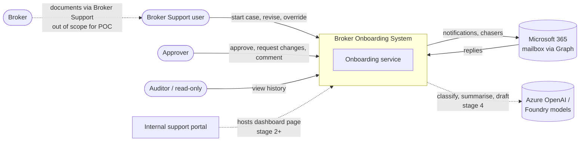
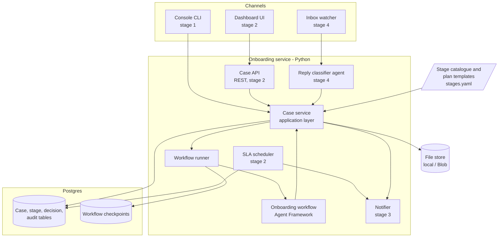
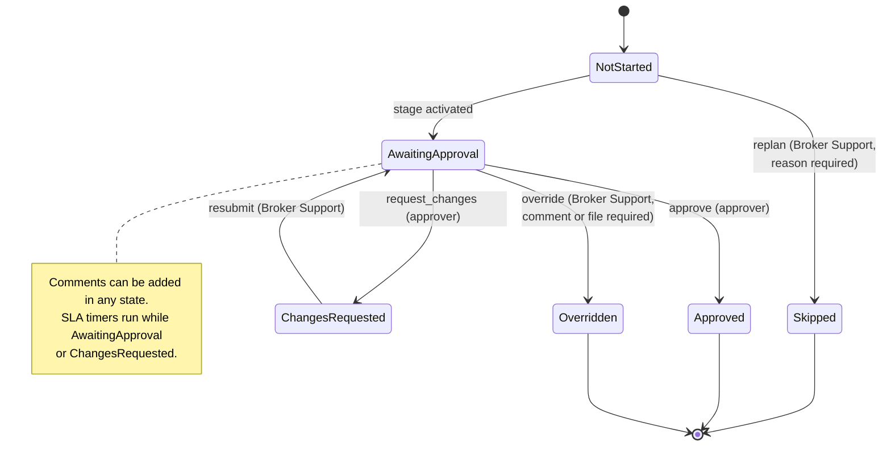
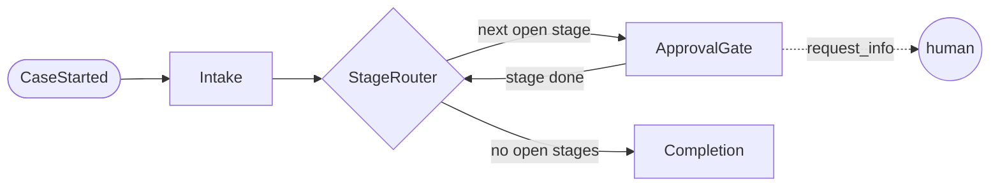
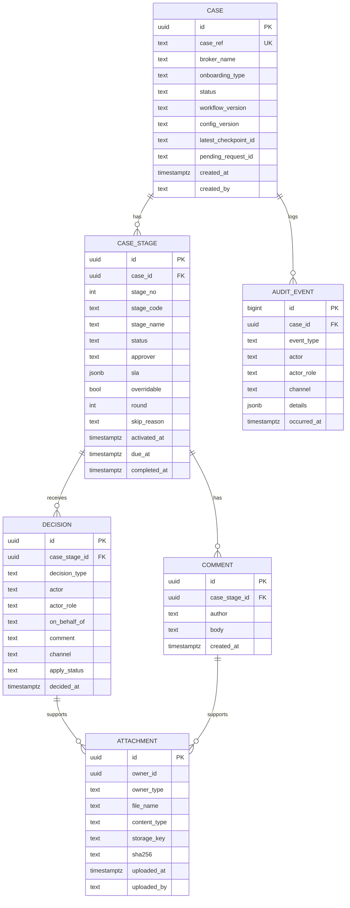
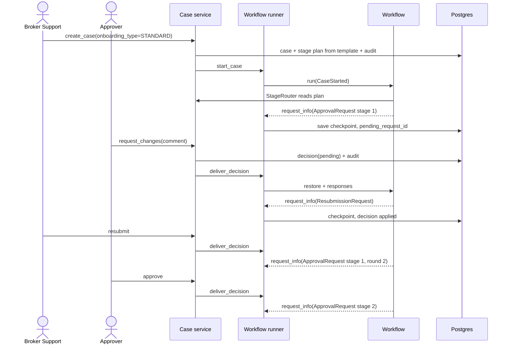
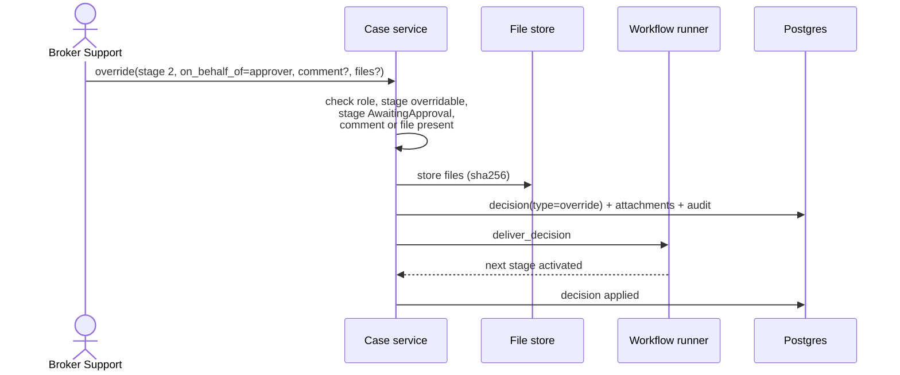

# Broker Onboarding Workflow – Architecture & System Design

Status: **living document**. It describes the design as intended and is updated as components are built. Each component shows its delivery stage and build status.

Related: [OBJECTIVES.md](OBJECTIVES.md) (the why), section numbers below (the how).

| Status key | Meaning |
|---|---|
| 🟦 Designed | Design agreed, not built |
| 🟨 In progress | Being built |
| 🟩 Built | Built and demoed |
| ⬜ Later | Outline only, depends on discovery or later stages |

---

## 1. Architecture overview

### 1.1 Guiding principles

1. **Thin workflow, our own state.** The Agent Framework workflow only decides "what's the next step" and holds the pause/resume point. The case, stage, decision, audit and file data live in our own tables, which are the **system of record** (O4, O5).
2. **Stages are data, planned per case.** Configuration defines a catalogue of stages and a plan template for each onboarding type. Each case gets its own stage plan, copied from its template into the case tables when the case is created. The workflow graph never names a business stage, so stages can be added, reordered or skipped without changing the workflow.
3. **Every channel ends in the same place.** Console, dashboard, email link, email reply and Broker Support override all become a `StageDecision` delivered to the paused workflow.
4. **AI suggests, people decide.** Model calls are optional nodes that never approve anything by themselves (O7).
5. **Easy to port, easy to host.** Configuration comes from the environment. Storage, clock and notifications sit behind small interfaces, so local versions can be swapped for Azure ones, and the workflow layer can be rewritten in .NET (Objectives §8).

### 1.2 System context



### 1.3 Containers and components



**Data ownership:**
- The **case service** is the only component that writes the case tables.
- The **workflow runner** is the only component that reads and writes checkpoints.
- Executors in the workflow call back into the case service to record what happened. They never write SQL directly.

---

## 2. Domain model

### 2.1 Concepts

| Concept | Description |
|---|---|
| **Case** | One broker onboarding. Has a `case_ref` (e.g. `BRK-2026-0001`) that's used in email subjects and links. |
| **Onboarding type** | The kind of onboarding, e.g. `STANDARD` or `APPOINTED_REP` (real values come from discovery). Chosen when the case is created. Selects the plan template. |
| **Stage catalogue** | Every stage that exists (code, name, default approver, SLA, overridable), with no order. Defined in config. |
| **Plan template** | For one onboarding type, the ordered list of catalogue stages to use by default. Defined in config. |
| **Stage plan** | A case's own ordered list of stages. Copied from the template when the case is created, then owned by the case. Broker Support can change the not-yet-started part. |
| **Stage** | One approval step in a case's plan (a `case_stage` row). Has a position (`stage_no`), an assigned approver and an SLA, all snapshotted from config at creation. |
| **Decision** | An action on a stage: `approve`, `request_changes`, `override`, `resubmit`. Moves the workflow forward. |
| **Comment** | A note on a stage or case. Doesn't move the workflow. Written directly to the case tables. |
| **Attachment** | A supporting file linked to a decision or comment (e.g. override evidence). |
| **Audit event** | A record of every state change: who, what, when, channel, details. It's never updated or deleted. |
| **Workflow version** | The version of the workflow *code* (graph and executors) a case started on. Stamped on the case and never changed after start (O5). |
| **Config version** | The version of `stages.yaml` the case's plan was copied from. Recorded for traceability only: the plan is already snapshotted, so config changes never affect cases in progress. |

### 2.2 Stage lifecycle



Open (meeting Q7): can a stage be overridden while it's in `ChangesRequested`? Is there a terminal `Rejected` state for the whole case (broker declined)? Both are left out until discovery.

### 2.3 Case lifecycle

`Draft → InProgress → Completed`, plus `Withdrawn` (Broker Support cancels the case) and later possibly `Declined`. A case is `InProgress` from start until every stage in its plan is `Approved`, `Overridden` or `Skipped`.

---

## 3. Component designs

### 3.1 Onboarding workflow (Agent Framework) — 🟦 Designed · stage 1

**Responsibility:** ask "what's the next stage in this case's plan?", pause for a decision on it, and resume when one arrives.

**Graph:** a small, fixed loop that's the same for every case and onboarding type. It doesn't name any business stage. The order comes from the case's stage plan in the case tables (ADR-009).



**Executors**

| Executor | Input | Behaviour | Output |
|---|---|---|---|
| `Intake` | `CaseStarted(case_id)` | Records case start through the case service | `RouteNext(case_id)` |
| `StageRouter` | `RouteNext` | Reads the case's plan from the case service and finds the lowest `stage_no` that is `NotStarted`. Skipped and completed stages are passed over. | `ActivateStage(case_id, stage_id)`, or `AllStagesDone` |
| `ApprovalGate` | `ActivateStage` | Marks the stage `AwaitingApproval` and calls `ctx.request_info(ApprovalRequest)`. Then pauses. | — |
| `ApprovalGate` | `@response_handler StageDecision` | `approve` / `override` → completes the stage. `request_changes` → marks the stage `ChangesRequested` and issues `request_info(ResubmissionRequest)` to Broker Support. `resubmit` → issues `ApprovalRequest` again to the same approver. | On completion: `RouteNext(case_id)` |
| `Completion` | `AllStagesDone` | Marks the case `Completed` and yields the workflow output | final output |

**Why this shape:**
- The router reads the plan every time, so a replan (reorder, add or skip a not-yet-started stage) takes effect at the next routing step with no change to the workflow or its checkpoint.
- The pushback loop lives inside the gate, not as graph edges (ADR-005), so the graph stays tiny and identical for every stage.
- Only one stage is active at a time in the POC. Parallel stages (two stages with the same `stage_no`) are ⬜ Later.

**Messages and requests** (dataclasses, also used as the API contract):

```text
ApprovalRequest      case_id, stage_no, stage_code, approver, round, summary
ResubmissionRequest  case_id, stage_no, stage_code, requested_by, reason, round
StageDecision        case_id, stage_no, decision_type, actor, actor_role,
                     on_behalf_of?, comment?, attachment_ids[], channel, decided_at
```

**Checkpoint state** in the gate (`on_checkpoint_save` / `on_checkpoint_restore`) is limited to the active `stage_id`, `round` and the pending request kind. Everything else is read from the case tables.

**Open technical questions** (answer during stage 1):
- Does a cycle (router ↔ gate) restore cleanly from a checkpoint taken while paused inside the gate?
- Do the gate's pending requests survive restore unchanged?
- What happens to a paused case when the workflow *code* changes? (versioning experiment, §6)

### 3.2 Workflow runner — 🟦 Designed · stage 1

**Responsibility:** the bridge between one case and one workflow instance.

- `start_case(case_id)`: builds the workflow for the case's `workflow_version`, runs it until the first `request_info`, and stores the checkpoint ID and pending request ID on the case.
- `deliver_decision(case_id, decision)`: loads the case's latest checkpoint, restores the workflow, matches the pending `request_id`, runs with `responses={request_id: decision}` until the next pause, and stores the new checkpoint ID.
- **Concurrency:** a Postgres advisory lock on `case_id`, so only one decision is applied to a case at a time.
- **Version routing:** keeps a registry of `workflow_version → builder function`. Old versions stay registered until their cases finish (O5).

Note: the example `PostgresCheckpointStorage` keys checkpoints by `workflow_name` only. We need one per case, so the runner records `latest_checkpoint_id` on the case row and loads by ID. It never uses "latest for workflow".

### 3.3 Case service — 🟦 Designed · stage 1

**Responsibility:** the application layer. It validates commands, writes case data and audit events, and calls the runner.

| Command | Who | Rules |
|---|---|---|
| `create_case(broker details, onboarding_type)` | Broker Support | Looks up the plan template for `onboarding_type` and copies its stages into `case_stage` rows (snapshotting name, approver, SLA and overridable). Stamps `workflow_version` and `config_version`, then starts the workflow. |
| `replan(case, changes, reason)` | Broker Support | Reorder, add (from the catalogue) or skip stages. Only stages in `NotStarted` can be touched. `reason` is required. Audited as `plan_changed` with the before and after plan. |
| `decide(case, stage, approve \| request_changes)` | Assigned approver (or delegate) | The stage must be `AwaitingApproval`, and the actor must be the approver. `request_changes` requires a comment. |
| `override(case, stage, on_behalf_of, comment?, files?)` | Broker Support | The stage must be `AwaitingApproval`. `on_behalf_of` is required. **At least one of comment or file.** Recorded as `override` (O8). |
| `resubmit(case, stage, comment?)` | Broker Support | The stage must be `ChangesRequested` |
| `add_comment(case, stage?, text, files?)` | Anyone with access | Doesn't touch the workflow |
| `withdraw(case, reason)` | Broker Support | Ends the case. Pending requests are abandoned. |

**Consistency:**
1. The decision row and audit event are written with status `pending` in one transaction.
2. The runner applies the decision.
3. The row is marked `applied`.

If step 2 fails, the row stays `pending` and is retried or flagged. The POC doesn't build automatic reconciliation. It just makes the gap visible.

### 3.4 Data store (Postgres) — 🟦 Designed · stage 1



- `case_stage` has a unique constraint on `(case_id, stage_no)` and on `(case_id, stage_code)`. `stage_no` is the position in **this case's** plan. `stage_code` identifies the catalogue stage.
- `stage_name`, `approver`, `sla` and `overridable` are copied from config at creation, so later config changes don't alter cases in progress.
- `workflow_checkpoints` is a separate table owned by the runner (from the repo example), and isn't part of the domain model.
- `AUDIT_EVENT` is insert-only. In production, revoke `UPDATE` and `DELETE` on it.
- Elapsed time per stage (O2) is calculated as `completed_at − activated_at`, or `now − activated_at` while the stage is open.

### 3.5 Stage configuration — 🟦 Designed · stage 1

Two parts: a **catalogue** of stages (no order) and **plan templates**, one per onboarding type (ordered lists of catalogue codes).

```yaml
# poc/config/stages.yaml  (illustrative – replaced after discovery)
version: "2026-11-v1"

catalogue:
  COMPLIANCE:
    name: Compliance review
    approver: compliance.lead@example.test
    sla: { remind_after: PT5M, escalate_after: PT10M, escalate_to: compliance.manager@example.test }
    overridable: true
  RISK:
    name: Risk sign-off
    approver: risk.officer@example.test
    sla: { remind_after: PT5M, escalate_after: PT10M, escalate_to: risk.head@example.test }
    overridable: false
  OPS:
    name: Operations setup
    approver: ops.manager@example.test
    sla: { remind_after: PT5M, escalate_after: PT10M, escalate_to: ops.head@example.test }
    overridable: true

plan_templates:
  STANDARD:      [COMPLIANCE, RISK, OPS]
  APPOINTED_REP: [RISK, COMPLIANCE]
```

- `onboarding_type` on the case is a key into `plan_templates`. It's the field that tells cases with different plans apart.
- Validation on load: every template entry must exist in the catalogue, and no code may appear twice in a template.
- POC timings are in minutes (ISO 8601 durations), so a full demo fits in one sitting (O3).
- `overridable` anticipates meeting Q7.
- ⬜ Later: rules that adjust the template automatically (e.g. add a stage for a particular product), instead of only Broker Support replanning by hand.

### 3.6 Console CLI — 🟦 Designed · stage 1

A stand-in for the dashboard, so stage 1 needs no UI. It calls the case service directly.

```text
poc new-case "Acme Brokers" --type STANDARD
poc list [--pending-for <approver>]
poc show <case_ref>                  # plan, elapsed time, decisions, audit
poc replan <case_ref> --as <user> --order RISK,COMPLIANCE,OPS [--skip OPS] [--add CODE] --reason "..."
poc approve <case_ref> --as <user>
poc request-changes <case_ref> --as <user> --comment "..."
poc resubmit <case_ref> --as <user> [--comment "..."]
poc override <case_ref> --as <user> --on-behalf-of <approver> [--comment "..."] [--file path]...
poc comment <case_ref> --as <user> "..."
```

`--as` simulates identity in the POC. Real identity is Entra ID (§5).

### 3.7 Case API and dashboard — ⬜ Later · stage 2

- REST over the case service (FastAPI is the likely choice for the Python POC). Endpoints map one-to-one to the case-service commands, plus `GET /cases`, `GET /cases/{ref}` and `GET /my-tasks`.
- The dashboard has three views: **My tasks**, **Case detail** (timeline, elapsed time per stage, comments, files, override badge) and **All cases** for Broker Support.
- The UI technology depends on how the support portal can host the page. To be decided after discovery.

### 3.8 SLA scheduler — ⬜ Later · stage 2

- Runs as a periodic job **outside the workflow**. It queries open stages where `now > activated_at + remind_after` (or `escalate_after`), sends a notification and writes an audit event.
- Escalation can reassign `case_stage.approver`. The workflow doesn't need to change, because the approver lives in our tables (ADR-001).
- The clock sits behind an interface, so tests and demos can fast-forward time.

### 3.9 Notifier — ⬜ Later · stage 3

Sends an email through Microsoft Graph from a shared mailbox. Each email includes the case ref in the subject (`[BRK-2026-0001]`) and a deep link to the case in the dashboard. The interface is `notify(recipient, template, case)`. The POC implementation prints to the console or a log.

### 3.10 Inbox watcher and reply classifier — ⬜ Later · stage 4

Uses Graph change notifications for the shared mailbox. For each reply:
1. Match the case by the ref in the subject.
2. An agent classifies the reply as `approve`, `request_changes`, `query` or `unclear` and extracts any comment.
3. Create a **suggested** decision for a person to confirm on the dashboard. It's never applied automatically (O7).
4. Keep the original email as an attachment for the audit trail.

### 3.11 File store — 🟦 Designed (local) · stage 1/2

Uses a `FileStore` interface (`put`, `get`, `url`). The POC stores files locally under `poc/.data/files/`, and production uses Azure Blob. The SHA-256 hash is recorded for tamper evidence. Size and type limits will be set before stage 2.

---

## 4. Key flows

### 4.1 Approve with pushback



### 4.2 Broker Support override (O8)



### 4.3 Restart and resume

1. The process stops while cases are paused at various stages.
2. On the next command for a case, the runner reads `latest_checkpoint_id` and `workflow_version` from the case row.
3. It builds the workflow version that matches, restores the checkpoint, and delivers the decision.
4. No other state is needed, because everything else is in the case tables.

---

## 5. Cross-cutting concerns

| Concern | POC | Production (see Objectives §8) |
|---|---|---|
| Identity | `--as <user>` flag; roles in config | Entra ID, app roles `Approver`, `BrokerSupport`, `Reader` |
| Authorisation | Checked in the case service | Same place, using roles from the token |
| Audit | `audit_event` table, insert-only | Same, plus no `UPDATE`/`DELETE` grants and retention policy |
| Configuration | `.env` + `stages.yaml` | App settings / Key Vault; stage config versioned in source control |
| Observability | Console logging | OpenTelemetry → Application Insights |
| Time | `Clock` interface, real time | Same; durable scheduler |
| Data | Fake brokers only | Data classification and security sign-off before any model use |
| Checkpoint serialisation | Pickle (as in the repo example), trusted DB only | Review: prefer a non-pickle serialiser if the framework supports one |

---

## 6. Versioning design (O5)

There are two kinds of change, handled differently:

| Change | Example | Effect on cases in progress |
|---|---|---|
| **Config** (`config_version`) | Add, reorder or remove a stage in a template. Change an approver or SLA. | None. Each case's plan was snapshotted at creation. New cases pick up the new config. Existing cases change only through an audited `replan`. |
| **Workflow code** (`workflow_version`) | Change executors, messages or the router/gate loop | Risky, because checkpoints are tied to the code. The runner keeps a builder for every `workflow_version` that still has live cases, and routes each case to its own. |

Because stages are data (ADR-009), most business changes are config changes, and code changes should be rare.

**Stage 1 experiment:**
1. Start a case and pause it at its second stage.
2. Change the config (add, reorder and remove stages) and confirm the paused case is unaffected and new cases get the new plan.
3. Change the workflow code: rename an executor, add a field to a message, and add an executor. Try to restore the paused case after each change and record what happens.
4. Write the results into the decision log (§8).

---

## 7. Proposed code layout

```text
poc/
  OBJECTIVES.md
  ARCHITECTURE.md
  config/stages.yaml
  src/broker_onboarding/
    domain/        # dataclasses: Case, Stage, StageDecision, requests
    workflow/      # executors, builder registry by version
    runner.py      # WorkflowRunner
    service.py     # CaseService (commands, validation)
    persistence/   # repositories, PostgresCheckpointStorage, schema.sql
    files.py       # FileStore (local)
    clock.py
    cli.py
  tests/
```

---

## 8. Architecture decisions (ADR log)

| # | Decision | Why | Status |
|---|---|---|---|
| ADR-001 | Our own case tables are the system of record. The workflow is thin. | Survives workflow changes and a language port. Supports audit and dashboard queries. | Accepted |
| ADR-002 | Python for the POC | Runs easily locally and the repo has examples. A .NET rewrite is possible later (Objectives §8.1). | Accepted |
| ADR-003 | Postgres for checkpoints and case data | Durable across restarts, and already in the dev container | Accepted |
| ADR-004 | SLA timers run outside the workflow | Restart-safe, and escalation can reassign without touching the workflow | Accepted |
| ADR-005 | The pushback loop lives inside `ApprovalGate`, not as graph edges | Keeps the graph tiny and identical for every stage. Easier to version and port. | Proposed – revisit after the stage 1 build |
| ADR-006 | Override is a distinct decision type and needs a comment or a file | Auditors must tell overrides apart from direct approvals (O8) | Accepted |
| ADR-007 | Comments don't go through the workflow | They don't change control flow, so this avoids needless checkpoint churn | Accepted |
| ADR-008 | AI only suggests decisions | Bank control requirements (O7) | Accepted |
| ADR-009 | Each case has its own stage plan. The workflow is a fixed router ↔ gate loop that reads the plan, instead of one executor per configured stage in a fixed chain. | Lets order differ per case and change mid-case. Config changes no longer change the graph, so they don't break checkpoints. | Accepted (replaces the fixed chain in the initial design) |
| ADR-010 | `onboarding_type` selects a plan template. The plan is snapshotted into `case_stage` at creation, and `config_version` is recorded separately from `workflow_version`. | Separates "which stages, in what order" (data) from "how the engine runs" (code). Config edits never alter cases in progress. | Accepted |

---

## 9. Changelog

| Date | Change |
|---|---|
| 2026-11-21 | Initial architecture, before discovery with Broker Support |
| 2026-11-21 | Stage plan per case: `onboarding_type` + plan templates, router ↔ gate loop, `replan` command, `Skipped` state, `config_version` (ADR-009, ADR-010) |
